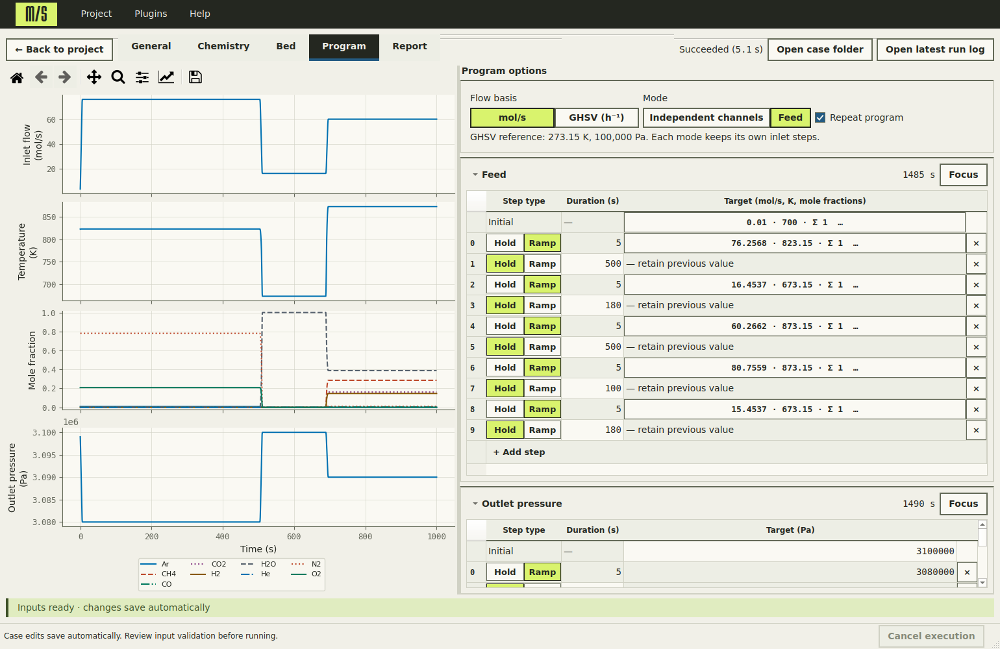

# MultiSolid-CL

**MultiSolid-CL simulates the behaviour of reactive packed beds, coupling gas
flow, heat transfer, and chemical reactions.** Run simulations (cases) through
the desktop application or command line, and compare the effects of solid
loadings, gas feeds, and operating conditions with parameter studies. Add your
own species and reactions to extend the chemistry. Share collections of
simulations (projects) with their case configurations and chemistry extensions
intact.

| [I want to simulate a reactor](#i-want-to-simulate-a-reactor) | [I want to develop or extend the software](#i-want-to-develop-or-extend-the-software) |
| --- | --- |
| Download the app, open the example, run it, change a parameter, and compare results. | Install from source, author plugins, and explore the equations and implementation. |



*Program a nickel-based reactive bed in Feed mode and preview how conditions
change over time. This view combines the example's inlet channels into feed steps.*

## I want to simulate a reactor

1. **Download and launch MultiSolid.** Follow the
   [desktop installation instructions](#install-the-desktop-application).
   The first public desktop release is pending; until then, use the source
   installation or build instructions linked there.
2. **Open the supplied project.** Download
   [first-reactor.msproject](examples/projects/first-reactor.msproject)
   using GitHub's **Download raw file** button. On the welcome screen, choose
   **Import archived project**, select the file, and choose a local project
   folder outside the application directory. It contains a ready-to-run
   **Baseline** case, using the supplied nickel chemistry and gas-feed program.
3. **Run it.** Choose **Run** beside **Baseline**. The first Compiled run may
   take several minutes to build its model. After **Succeeded**, open the case
   and choose **General → Requested plots → Outlet composition → Show** to see
   the inlet and outlet gas compositions over time.
4. **Change one operating parameter.** Return to the project, **Duplicate**
   Baseline, and name the copy **Lower flow**. In the copy's **Program** tab,
   change the **Inlet flow** first ramp target (step **0**) from **76.2568** to
   **60 mol/s**. Return to the project and run the copy. Duplicating preserves
   the baseline's results; rerunning the original would replace them.
5. **Compare the results.** Open the **Outlet composition** plot for each case
   and compare the curves. For a table or Excel export, choose **Results…** on
   the project screen and select both cases; the
   [comparison guide](docs/GUI-GUIDE.md#compare-cases-in-project-results)
   explains how to arrange the recorded quantities side by side.

Continue with the [GUI guide](docs/GUI-GUIDE.md) or set up a
[parameter study](docs/GUI-GUIDE.md#parameter-studies) to vary several inputs.
For terminal workflows, use the [CLI guide](docs/CLI-GUIDE.md).

## I want to develop or extend the software

- **Install from source:** follow the
  [source installation](#install-the-full-repository-from-source) for the engine,
  CLI, and desktop application in one editable environment.
- **Add chemistry:** work through the [plugin tutorials](examples/plugins/README.md)
  to add species, property equations, and reaction rates, then use the
  [plugin reference](docs/PLUGINS.md) to package and share them.
- **Understand the model:** read the [equations and assumptions](docs/EQUATIONS.md),
  including the [equation-to-code map](docs/EQUATIONS.md#configuration-and-implementation-map)
  and [kinetics sources](packed_bed/kinetics/KINETICS_SOURCES.md).
- **Change the implementation:** use the [repository map](#repository-structure)
  and [development guide](#development) for code entry points and validation,
  or [build a desktop distribution](desktop/BUILDING.md).

---

## Documentation

The guides below cover model equations and the plugin, desktop, and
command-line workflows.

| Document | Contents |
| --- | --- |
| [Plugin guide](docs/PLUGINS.md) | Creating, using, checking, and sharing plugins; manifest and Python API reference |
| [Model equations](docs/EQUATIONS.md) | Governing equations, assumptions, boundary conditions, source terms, and numerical treatment |
| [GUI guide](docs/GUI-GUIDE.md) | Case editing, first run, projects, studies, plots, and Excel reports |
| [CLI guide](docs/CLI-GUIDE.md) | Complete first case, YAML inputs, single runs, batches, outputs, and Python API |
| [Desktop installation](docs/help/installation.md) | Installing and updating the desktop application |
| [Build from a checkout](desktop/BUILDING.md) | Prerequisites and one-command Linux/Windows desktop builds |
| [Linux build guide](desktop/BUILD_LINUX.md) | Linux packaging, native portability, and release checks |
| [Windows build guide](desktop/BUILD_WINDOWS.md) | Building, validating, and packaging the desktop distribution |
| [Plugin examples](examples/plugins/README.md) | Step-by-step creation of a species, custom property equation, and reaction |
| [Kinetics sources](packed_bed/kinetics/KINETICS_SOURCES.md) | References for the built-in reaction families |
| [Third-party notices](THIRD_PARTY_NOTICES.md) | Dependency attribution and accompanying licences |

### Plugins

Documentation for official scientific plugins:

| Plugin | Contents |
| --- | --- |
| [Waste iron](plugins/waste_iron/README.md) | Installation, kinetics, property definitions, and provenance |

## Install the desktop application

The first public desktop release is pending. Once published, download it from
[GitHub Releases](https://github.com/Griminir5/multisolid-CL/releases). Until then,
use the source installation below, or follow
[Build MultiSolid from a checkout](desktop/BUILDING.md) to create a Linux or
Windows distribution. After the documented system prerequisites, run
`python3.12 tools/build_desktop.py --headless` on Ubuntu 24.04, or
`py -3.11 tools/build_desktop.py` in Windows PowerShell. Each creates an isolated
build environment and a validated portable archive.

The Windows distribution targets **Windows 11 x64**. Choose one release asset:

| Asset | Installation |
| --- | --- |
| `MultiSolid-<version>-windows-x64-setup.exe` | Run the installer, then open MultiSolid from the Start menu. Installation is for the current user. |
| `MultiSolid-<version>-windows-x64-portable.zip` | Extract the entire ZIP into a new folder, then run `MultiSolid/MultiSolid.exe`. Keep its files and subfolders together. |

Both distributions include Python, DAETools, Graphviz, and the compiler and
libraries needed for Compiled execution. End users do not need to install these
separately. GitHub's automatically generated source archives are source code;
choose the installer or portable ZIP for the ready-to-run application.

Create projects in a writable folder outside the application directory. The first
Compiled run may take several minutes to build its model; compatible later runs
reuse the project's cache. To update a portable installation, extract the new
version into a new folder and open your existing project. The
[GUI guide](docs/GUI-GUIDE.md) explains the project workflow.

## Install the full repository from source

Use **Python 3.11 or 3.12** and Git. These steps install the engine, CLI, desktop
application, compiled-backend Python dependencies, and DAETools plotter support
in one environment. Windows and Linux need a matching DAETools distribution and
its native dependencies.

### 1. Get the source and create an environment

These instructions use the `application-and-ui` branch, which contains the
engine and desktop layout described here.

```sh
git clone --branch application-and-ui https://github.com/Griminir5/multisolid-CL.git
cd multisolid-CL
python -m venv .venv
```

Activate the environment in PowerShell:

```powershell
.\.venv\Scripts\Activate.ps1
```

Or in a Linux shell:

```sh
source .venv/bin/activate
```

Use `python3.11` or `python3.12` to create the environment if your default `python`
is a different version. Run the remaining repository commands from its root.

### 2. Install the Python packages

```sh
python -m pip install -e ".[compiled,plotter]" -e ./desktop
```

Editable installation makes local Python changes available without reinstalling.
The desktop package includes Excel export dependencies. Release builds use a
separate, pinned environment described in the Windows build guide.

### 3. Install DAETools

Download [DAETools 2.6.0](https://daetools.sourceforge.io/downloads.html) for your
operating system and Python version. Extract it, then, with the same virtual
environment active, install from the extracted DAETools directory:

```sh
python -m pip install .
```

Follow the DAETools installation instructions for its native dependencies. The
distribution must include the solver adapters you intend to use. The supplied
single-case example uses the desktop's Compiled/Band preset, which requires
DAETools with SuperLU to build the model and solve its initial conditions.
Return to the MultiSolid repository root after installation.

### 4. Install the external tools

- **Linux desktop libraries:** install the GUI prerequisites listed in the
  [Linux build instructions](desktop/BUILDING.md#linux), including
  `libxcb-cursor0` on Ubuntu. Python's Qt wheel still needs these native libraries
  for X11 startup.
- **Graphviz:** install the native Graphviz distribution with `neato` on `PATH`,
  or set `MULTISOLID_GRAPHVIZ` to the full path of its executable. This supplies
  the chemistry graph and CLI system diagram; no Python Graphviz binding is needed.
- **C++ compiler:** for source Compiled execution, install GCC or Clang on Linux
  and make it available on `PATH`; `CXX` can select its executable. On Windows,
  install Visual Studio Build Tools with C++ x64 support; the application locates
  its toolchain through the Visual Studio installer.

Without a managed native bundle, Compiled execution uses the pinned
`scikit-sundae==1.1.3` wheel's SUNDIALS runtime. Arbitrary system SUNDIALS libraries
are not interchangeable with that runtime. Compiled KLU requires the managed
bundle. See [native bundles](desktop/BUILD_WINDOWS.md#native-bundles) for staging
the Windows compiler, solver libraries, and Graphviz runtime. Source execution
also detects staged bundles under `desktop/vendor/`.

### 5. Check the installation and launch

```sh
python -m packed_bed examples/simulations/default_case/run.yaml --validate-only
packed-bed-ui
```

`python -m packed_bed_ui` also launches the desktop application. To run the
supplied case from the terminal:

```sh
python -m packed_bed examples/simulations/default_case/run.yaml
```

Validation of built-in definitions does not need DAETools. Python plugins may
load their own dependencies during validation; see the
[CLI validation notes](docs/CLI-GUIDE.md#what-validation-checks). Execution requires
the selected solver and its dependencies. Each case run can replace files in its
output directories; use separate directories to retain earlier results.

## Repository structure

| Path | Purpose |
| --- | --- |
| [`packed_bed/`](packed_bed/) | Simulation engine, CLI, configuration, scientific definitions, and reports |
| [`packed_bed/compiled/`](packed_bed/compiled/) | Native code generation, compiler integration, and SUNDIALS runtime support |
| [`desktop/`](desktop/) | Desktop package metadata, Windows build instructions, and installer definition |
| [`desktop/packed_bed_ui/`](desktop/packed_bed_ui/) | PyQt6 application, project storage, editors, studies, and Excel export |
| [`docs/`](docs/) | Model equations and the plugin, GUI, and CLI guides |
| [`examples/simulations/`](examples/simulations/) | Complete single-case and batch YAML inputs |
| [`examples/projects/`](examples/projects/) | Importable desktop project for the first-reactor walkthrough |
| [`examples/plugins/`](examples/plugins/) | Illustrative plugin packages |
| [`plugins/`](plugins/) | Additional scientific plugins |
| [`tools/`](tools/) | Runtime staging, wheel builds, desktop freezing, and release checks |
| [`.github/workflows/`](.github/workflows/) | Native runtime CI |

Generated runtimes, build outputs, and caches are excluded from Git. Licences and
scientific provenance notes stay beside the components they describe.

## Development

Use the editable source installation above. Keep release builds separate from
the development environment; the
[Windows build guide](desktop/BUILD_WINDOWS.md) defines the pinned release inputs
and acceptance checks.

Useful starting points are [configuration and validation](packed_bed/config/),
[model equations](packed_bed/model.py), [initialization](packed_bed/initialization.py),
[operating programs](packed_bed/programs.py), [simulation execution](packed_bed/simulation.py),
and [reports](packed_bed/reports.py). Desktop navigation starts in
[window.py](desktop/packed_bed_ui/window.py); project persistence is in
[project.py](desktop/packed_bed_ui/project.py).

Regenerate the README's example project from the supplied single-case inputs
with `python tools/create_example_project.py`. The archive contains inputs only;
the script also checks that it can be imported and resolved.

Use [scientific plugins](docs/PLUGINS.md) for new species, property correlations,
or reaction families that can be distributed independently. Changes to built-in
definitions should retain their scientific references, units, and concentration
bases. Keep DAETools imports lazy where possible so input validation remains
usable without the solver. When changing the model, preserve equation names,
ordering, and solver incidence unless the change deliberately requires otherwise.

Check the example inputs after configuration changes:

```sh
python -m packed_bed examples/simulations/default_case/run.yaml --validate-only
python -m packed_bed batch examples/simulations/default_batch_case/batch.yaml --validate-only
```

For native runtime changes, run the smoke check with a working compiler and a
managed runtime including KLU. It checks all three Compiled solvers; the
scikit-SUNDAE wheel alone cannot pass its KLU check. Linux bundles must work
without `LD_LIBRARY_PATH`; rebuild old bundles with the current staging tools:

```sh
python -m packed_bed.compiled.smoke
```

For packaging changes, build both application wheels with the configured build
dependencies installed:

```sh
python -m pip wheel --no-deps --no-build-isolation --wheel-dir build/wheels . ./desktop
```

The desktop's offline help is generated from the user guides, plugin documentation,
and short pages in `docs/help/`. Source installation and application build
instructions remain in the repository's Markdown files and are not bundled as
HTML. Generated HTML is checked in so source installations and
ordinary wheels can open help without documentation build dependencies. After
editing documentation, the help template, or the application version, rebuild
and check it:

```sh
python -m pip install --require-hashes -r tools/help-requirements.txt
python tools/build_help.py
python tools/build_help.py --check
```

The build validates internal page links and anchors and renders equations into
MathML. Search and styling are local assets. Release wheel builds reject stale
help; the frozen application collects the same files from the UI wheel.

Use complete reactor runs, balance diagnostics, and grid/tolerance comparisons
when changing numerical behaviour. Input validation and native smoke checks
alone do not validate a scientific model. Update the relevant documentation with
changes to interfaces, equations, or defaults.

## Attribution and citation

A **Zenodo DOI is planned for the first release**. Until it is issued, cite the
[repository](https://github.com/Griminir5/multisolid-CL) and record the version,
Git commit, and access date used for your work. For example, replace the fields
in this provisional citation:

> MultiSolid-CL contributors. *MultiSolid-CL* [Computer software]. Version
> VERSION, commit COMMIT. https://github.com/Griminir5/multisolid-CL
> (accessed DATE).

Once the first release is archived, this section will provide its Zenodo citation
and DOI. Cite the scientific sources for the kinetics and property data you use
as well: see the [built-in kinetics references](packed_bed/kinetics/KINETICS_SOURCES.md)
and the documentation shipped with each plugin. Run manifests record source and
configuration provenance to help identify the implementation behind results.

MultiSolid-CL is licensed under [GPL-3.0-only](LICENSE). Dependency attribution
and notices are in [THIRD_PARTY_NOTICES.md](THIRD_PARTY_NOTICES.md); bundled
components retain their accompanying licence texts.
